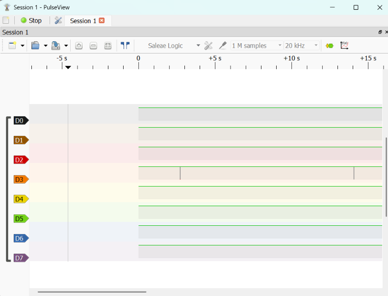
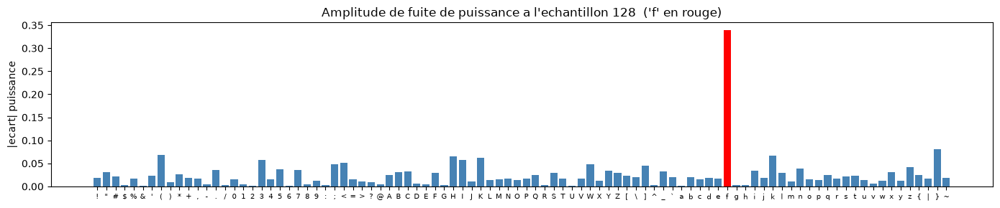

# Black-box power analysis attack — "The Vault"

> Project for the *Embedded Security* course — black-box attack on an Arduino Uno, built on top of the template provided by the teacher ([Embedded-Security](https://github.com/parastuffs/Embedded-Security/wiki)), using a ChipWhisperer-Nano as scope/glitcher.

## 1. Objective

The firmware running on the Arduino Uno protects a "vault" behind a password check. With no access to the source code, the goal was to:

1. physically figure out how to talk to the target,
2. bypass the password verification,
3. document the approach as an attack tree.

## 2. First contact with the target

After implementing the firmware into the Arduino Uno as instructed in the teacher GitHub, the first reflex is trying to communicated with the vault using the arduino USB connector using the standard bode rate of 115200. Unfortunately, the answer from the board was that it wasn't the main entrance.


Now we know we have to access the vault using different pin than the usual RX and TX.

## 3. Finding the right PIN

With the previous information, we can now try to fin the right PIN with a logic analyzer by connecting it to the Arduino and checking which pin receive a signal when we reset the board.



Once we found the TX pin (pin 11 on the Arduino), we can communicate with the board and find the RX pin. We find that it's on the Arduino pin 10 and that we have a bode rate of 9600 now.

The response we get now is the following


## 4. Attack process

### 4.1 Board external connection

For the attack, we had to use the chipwisperer nano provided by the teacher. To connect it with the Arduino Uno we followed the instruction on [Connecting to an external target](https://github.com/parastuffs/Embedded-Security/wiki/Connecting-to-an-external-target) github of the teacher which give the base configuration of the chipwisperer and how to connect everything together. 

As seen previously the RX and TX pin of the Arduino aren't the good one to access the main entrance of the vault, we had to find which pin of the AT omega was connected to the pin 10 and 11 of the Arduino. With the multimeter, we find that its the pin 16 and 17 of the AT omega and we also found out that the trigger was on the pin 19. We can now connect those pin with the CW-Nano:

| CW-Nano | AT-Omega |
|---|---|
| 2 | GND |
| 8 | VCC (5V) |
| 10 | 17 |
| 12 | 16 |
| 16 | 19 |
| Probe B | Middle PIN measure |

### 4.2 Attack principle (SPA - Simple Power Analysis)

The method we choose to use in this project was the SPA - Simple Power Analysis. It consist in check the power consumption of the board while trying different character because the code will consume more power if the information is correct than if it's false. Using this logic, we try 10 times each possible character and take the mean and compare it to the mean value of all the character. The one that's the furthest from the mean value is suppose to be the correct character.




## 5. Final code and result

Once we are sure that the code work we can use this method put it on loop that repeat the process and put every good answer in a list that's use to try the password at the end of every loop. If the code goes well we get the password after a few minutes and recover the salt and the hash.

```
>> ACCESS GRANTED: running protected section
Here is your salt: 49527679
Here is your hash: 05F730DB852CDFDB08140A0031093F1A65842FFA4D5092FE5495787EA02D3EF4

Enter password:
```

## 6. Attack tree

```mermaid
graph TD

```

## 7. Counter-measure

